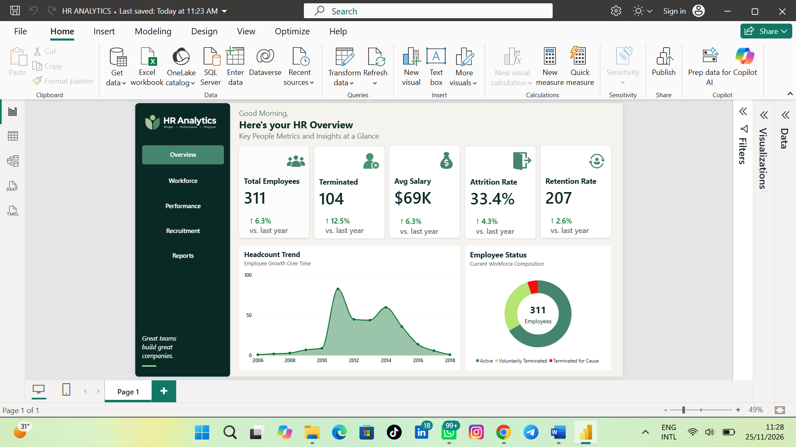

# HR Analytics Dashboard

## Project Overview

The HR Analytics Dashboard is a Power BI project designed to provide insights into workforce composition, employee retention, attrition, salary distribution, and employee growth trends.

The project focuses on transforming HR data into meaningful visual insights that can support data-driven human resource management and workforce planning.

## Dashboard Preview

## Key Performance Indicators (KPIs)

| KPI | Value |
|---|---:|
| Total Employees | 311 |
| Terminated Employees | 104 |
| Average Salary | $69K |
| Attrition Rate | 33.4% |
| Retained Employees | 207 |

## Dashboard Features

### Workforce Overview

- Total employee count.
- Employee termination figures.
- Average employee salary.
- Employee attrition and retention metrics.
- Headcount trend from 2006 to 2018.
- Employee status distribution across active, voluntarily terminated, and terminated for cause categories.

## Key Insights

- The organization has a recorded workforce of 311 employees.
- 104 employees have been terminated, representing an attrition rate of 33.4%.
- 207 employees remain in the workforce, representing approximately 66.6% of the total employee count.
- The average employee salary is $69K.
- Employee headcount trends are visualized across the 2006–2018 period.

## Tools and Technologies

- **Microsoft Power BI:** Dashboard development and data visualization.
- **Power Query:** Data transformation and preparation.
- **DAX:** Calculated measures and KPI development.
- **CSV:** Source data format.

## Project Status

The project currently contains a completed Workforce Overview page. Additional dashboard sections will be developed as the project progresses.

## Project Objectives

- Develop practical HR analytics and business intelligence skills.
- Identify workforce patterns and employee attrition trends.
- Present HR metrics through clear visualizations.
- Demonstrate data analysis and dashboard development skills.

---

**Author:** Lilian Ochagwuba

**Project Category:** Data Analytics | Human Resources Analytics
